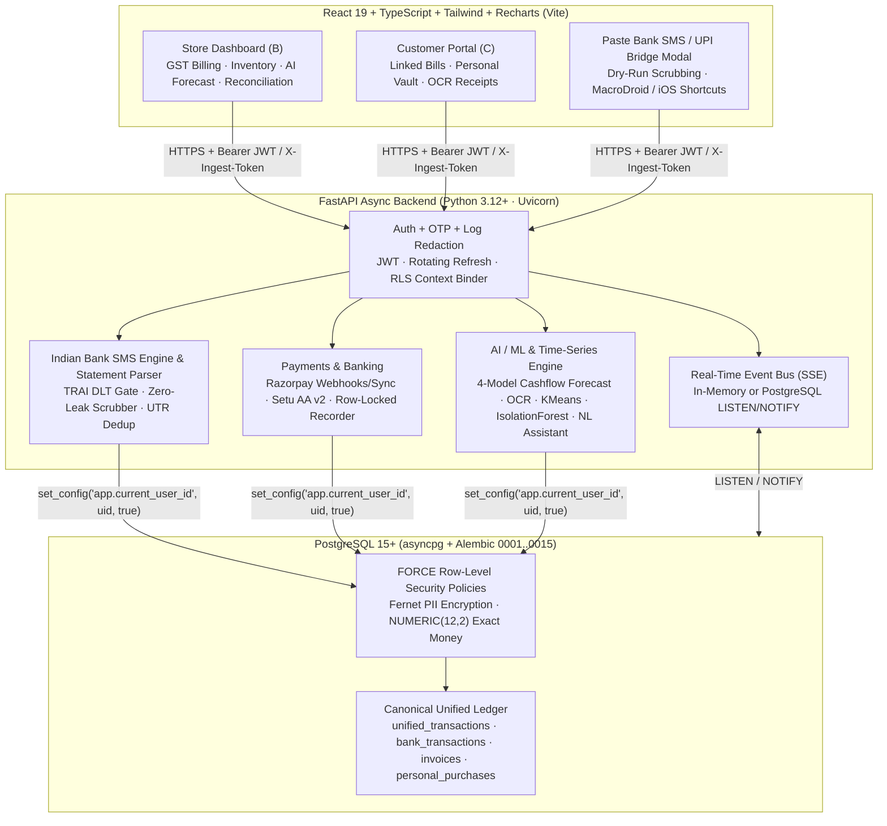
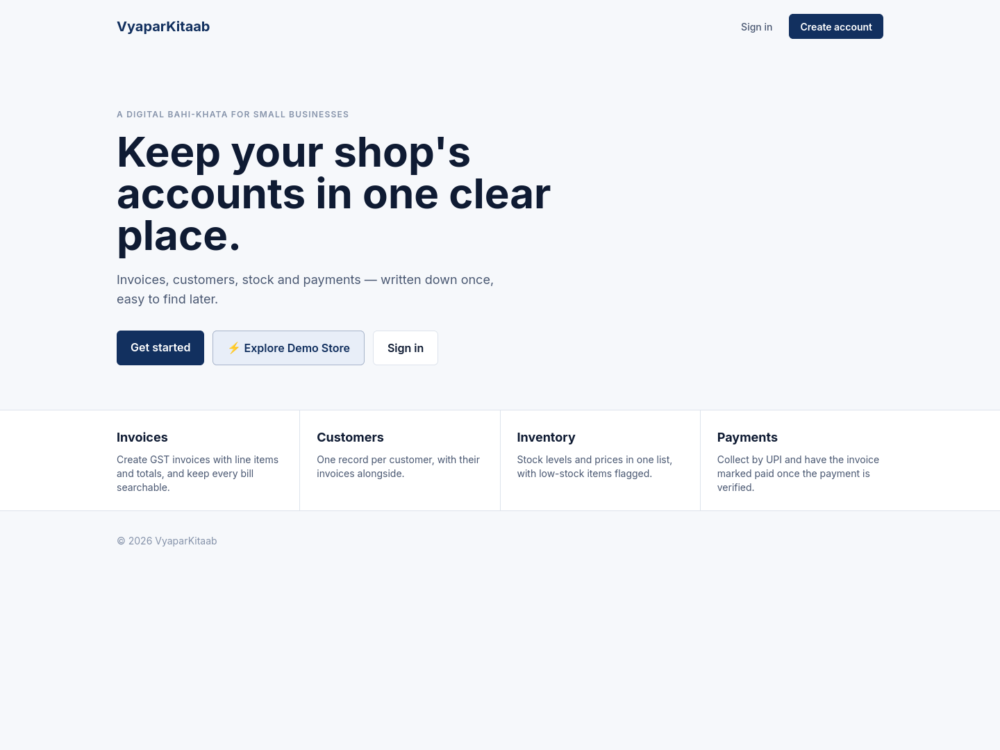
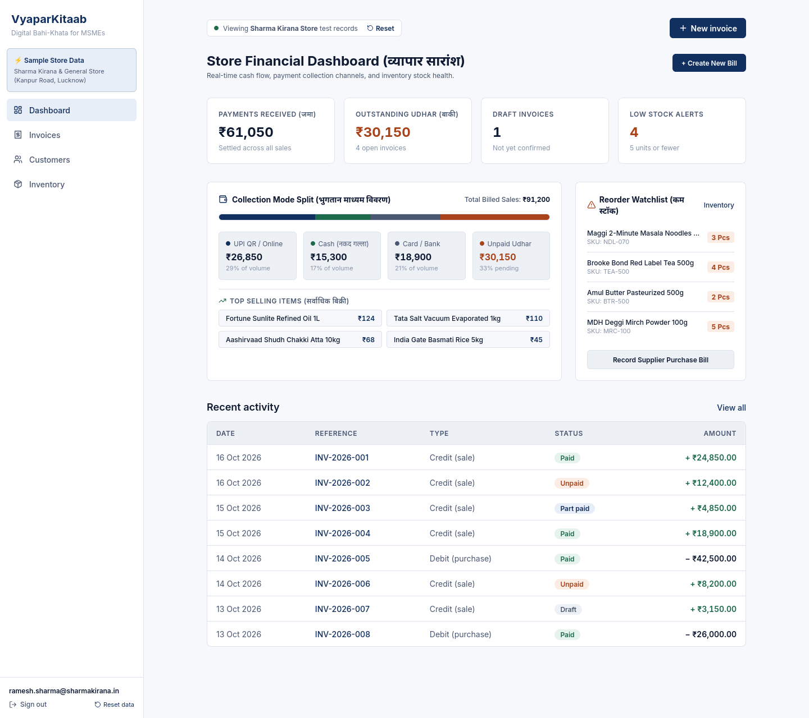
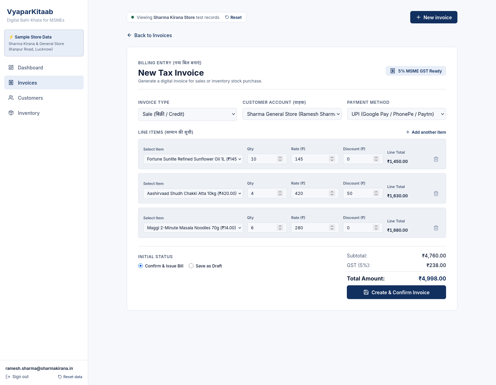
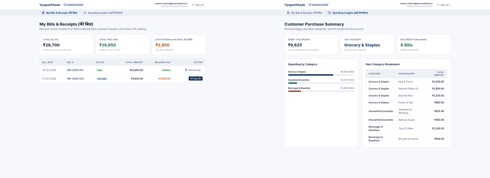

# 📒 VyaparKitaab

> **A Privacy-First, Two-Sided Intelligent Ledger, Bank SMS Streamliner & Cashflow Time-Series Platform for Indian MSMEs and Consumers**

[](https://github.com/VaibhavKumar2005/VyaaparKitaab)
[](https://www.python.org/)
[](https://fastapi.tiangolo.com/)
[](https://react.dev/)
[](https://www.typescriptlang.org/)
[](https://www.postgresql.org/)
[](#-testing--verification)
[](#license)

---

## Table of Contents

- [Overview](#-overview)
- [Core Capabilities](#-core-capabilities)
- [Zero-Leak Security & Financial Integrity](#-zero-leak-security--financial-integrity)
- [System Architecture](#-system-architecture)
- [Screenshots](#-screenshots)
- [Quick Start](#-quick-start)
- [Try It With Real Bank SMS (Zero Credential Exposure)](#-try-it-with-real-bank-sms-zero-credential-exposure)
- [Environment Configuration](#-environment-configuration)
- [API Reference Summary](#-api-reference-summary)
- [Testing & Verification](#-testing--verification)
- [Cloud Deployment](#-cloud-deployment)
- [Project Structure](#-project-structure)
- [Roadmap](#-roadmap)
- [Contributing, Team & License](#-contributing-team--license)

---

## 📖 Overview

Indian Micro, Small, and Medium Enterprises (MSMEs) and everyday UPI users still juggle paper khata books, scattered bank/UPI SMS alerts, PDF bank statements, GST billing tools, and personal expense spreadsheets.

**VyaparKitaab** unifies both sides of commerce into a single cloud platform backed by a **canonical unified ledger (`unified_transactions`)**:

- **Store Side (`B` — Business Dashboard):** GST-compliant invoicing (CGST/SGST/IGST + GSTR-1 CSV export), inventory & supplier tracking, Razorpay & UPI QR collection, real-time incoming payment alerts, bank-credit-to-invoice reconciliation, and AI cashflow forecasting.
- **Customer Side (`C` — Consumer Portal):** Linked store bills & purchase receipts, personal spending analytics across hierarchical categories (`Category → Subcategory`), receipt OCR scanning (printed & handwritten Hindi/English), bank/UPI SMS batch streamlining, and personal cashflow time-series analysis.

---

## ✨ Core Capabilities

### 1. Two-Sided MSME & Consumer Operations
- **GST Invoicing & Inventory:** Create sales/purchase invoices with automatic CGST/SGST/IGST splits, stock deductions, discount tracking, partial/full settlements, and one-click **GSTR-1 CSV export** (`/api/v1/invoices/export/gstr1`).
- **Store ↔ Customer Auto-Linking:** Blind-indexed phone/email matching connects store invoices to customer accounts without exposing raw PII across tenants, delivering real-time purchase & payment receipt notifications (`/api/v1/portal/notifications`).
- **Canonical Unified Ledger:** All channels — Store Invoices, Razorpay captures, Bank/UPI SMS alerts, PDF/CSV bank statements, and OCR personal receipts — normalize idempotently into `unified_transactions` with manual category/subcategory overrides.

### 2. Real Indian Bank & UPI SMS Streamlining Engine
Built for real-world Indian banking SMS formats (`HDFC`, `SBI`, `ICICI`, `Axis`, `Kotak`, `Google Pay`, `PhonePe`, `Paytm`) without ever asking for your bank password or MPIN:
- **TRAI DLT Sender Gate:** Parses Indian DLT headers (`AD-HDFCBK`, `VM-SBIUPI`, `JX-ICICIB`, `AX-AXISBK`, `JD-KOTAKB`, etc.) and automatically rejects `-P` promotional senders.
- **Strict Noise & Security Blockers:** Drops OTPs, MPIN/TPIN/CVV alerts, failed/declined transactions, UPI collect requests, and AutoPay mandate reminders before parsing.
- **Zero-Leak Pre-Persistence Scrubber:** Strips full account/card numbers (retaining only `XXXX-XXXX-last4`), PAN (`ABCDE1234F`), spaced Aadhaar numbers, URLs, API tokens (`vk_upi_`, `rzp_`, `AIza`, `sk_`, `ghp_`, JWTs), passwords, and **available balances (`Avl Bal` / `Bal` / `Avl Lmt`)** *before* amount extraction and *before* writing to PostgreSQL.
- **Chronological Date Extraction & Exact `Decimal` Math:** Extracts historical dates (`26/11/26`, `26Nov26`, `24-Nov-26`, `2026-11-26`) so pasted multi-day messages build an accurate time series, handles dual-cue SMS (`Acct debited ...; BLINKIT credited`) accurately, and deduplicates by UTR/reference number.
- **Multiple Ingestion Modes:**
  - **Paste Bank SMS UI** (with `Preview & Scrub (Dry Run)` before committing to the database).
  - **Automated Webhook Bridge** (`X-Ingest-Token` header) compatible with **Android MacroDroid / Tasker** and **iOS Shortcuts** for single or batch forwarding.

### 3. Unified Cashflow Time-Series & AI / ML Suite
- **Unified Cashflow Time-Series (`/api/v1/ai/cashflow-timeseries`):**
  - Aggregates every streamlined source (`sms_upi`, `razorpay`, `statement`, `store_invoice`, `ocr_purchase`) into continuous daily or weekly chronological series (`inflow`, `outflow`, `net_cashflow`, `cumulative_net`, 7-day rolling averages).
  - Runs a **chronological 80/20 walk-forward comparison** across **4 models** — `SMA-7`, `Holt-Linear`, `RidgeRegression`, and `RandomForestRegressor` (`StandardScaler` fitted strictly on the training split to prevent data leakage) — automatically picking the lowest-RMSE model for both inflow and outflow.
  - Produces **empirical 80% prediction intervals (`lower` / `upper`)**, **day-of-week seasonality (`Mon–Sun`)**, and **statistical daily spike anomaly flags**.
- **Invoice & Receipt OCR (`/api/v1/purchases/ocr-invoice`):** In-memory OCR using **Tesseract (`hin+eng`)** with optional **Gemini Vision** fallback for handwritten/regional Indian bills, extracting merchant, GSTIN (with checksum validation), line items, tax, discount, and date. Uploaded images are never persisted.
- **3-Tier Transaction Classifier:** Deterministic merchant/UPI rules → TF-IDF + LogisticRegression classifier → safe fallback across hierarchical categories.
- **Outgoing Payee Intelligence:** `KMeans` + `PCA` payee tier segmentation (with optimal `silhouette_score` selection) and `IsolationForest` outgoing payment anomaly detection (`/api/v1/purchases/payments-to-others`).
- **Natural-Language Business Assistant (`/api/v1/ai/assistant`):** Answers live queries over your tenant-scoped ledger (profit, receivables, restock needs, category spend, cashflow outlook).

### 4. Payments, Banking & Real-Time Streaming
- **Razorpay + UPI Intents:** Creates payment orders with dynamic store UPI QR codes (`upi://pay?...`), Razorpay Checkout modal, HMAC-SHA256 webhook verification, and one-click Razorpay payment history sync (`/api/v1/payments/sync-history`).
- **Bank Statement Importer & Reconciliation:** Parses CSV and PDF (including password-protected PDF) bank statements, then surfaces high-confidence **1-click Bank Credit ↔ Unpaid Invoice reconciliation** suggestions (`/api/v1/banking/reconcile/suggestions`).
- **RBI Account Aggregator (Setu AA v2):** Built-in consent initiation/authorization/revocation flow supporting both Setu AA Sandbox/Production (`BANK_DATA_PROVIDER=setu_aa`) and honest clearly-labeled local sandbox simulation (`mock`).
- **Cross-Replica Real-Time SSE:** Server-Sent Events (`/api/v1/streams/payments`, `/api/v1/streams/store/{store_id}`) backed by either in-memory queues (single node) or **PostgreSQL `LISTEN`/`NOTIFY`** (`EVENT_BUS_BACKEND=postgres`) for multi-replica deployments.

---

## 🔒 Zero-Leak Security & Financial Integrity

VyaparKitaab is engineered with defense-in-depth so personal and business ledgers remain strictly isolated even under real multi-user beta traffic:

| Layer | Implemented Safeguard | Source |
| :--- | :--- | :--- |
| **Database Tenant Isolation** | PostgreSQL **`FORCE ROW LEVEL SECURITY`** on `personal_purchases`, `bank_transactions`, `banking_consents`, `refresh_tokens`, `unified_transactions`, and `customer_notifications`. Bound per-request via `set_config('app.current_user_id', :uid, true)` (`is_local=true` clears on commit/rollback to prevent `asyncpg` pool leakage). | [0015_beta_rls_policies.py](backend/alembic/versions/0015_beta_rls_policies.py), [rls.py](backend/app/cores/rls.py) |
| **PII Encryption at Rest** | Symmetric Fernet encryption (`EncryptedString`) for GSTIN, addresses, phone numbers, emails, and order IDs, paired with deterministic HMAC-SHA256 blind indexes (`phone_hash`, `email_hash`, `order_id_bidx`) for exact lookups without exposing plaintext. | [encryption.py](backend/app/services/encryption.py) |
| **Auth & Session Hardening** | `bcrypt` password hashing, short-lived JWT access tokens + rotating refresh tokens with server-side revocation, JSON-body OTP endpoints (never putting phone numbers or OTP codes in URL query strings), and zero hardcoded dev OTP backdoors outside `ENV=testing`. | [auth.py](backend/app/routers/auth.py), [otp.py](backend/app/services/otp.py) |
| **Log Redaction** | Installed logging filters on `uvicorn.access` and `httpx` automatically redact `phone`, `otp`, `token`, `password`, `authorization`, and API key patterns from server logs. | [log_redaction.py](backend/app/cores/log_redaction.py) |
| **Shared Rate Limiting** | PostgreSQL-backed sliding-window rate limiter (`rate_limit_hits`) across login, OTP, and UPI SMS ingest endpoints so limits hold across multiple workers/replicas. | [rate_limit.py](backend/app/cores/rate_limit.py) |
| **Exact Financial Math & Concurrency** | All monetary columns use PostgreSQL `NUMERIC(12, 2)` and Python `Decimal` (`ROUND_HALF_UP`). Invoice settlements acquire row-level locks (`SELECT ... FOR UPDATE`) to block concurrent double-pay / overpayment race conditions. | [money.py](backend/app/cores/money.py), [payment_recorder.py](backend/app/services/payment_recorder.py) |
| **HTTP Security Headers** | Strict `Content-Security-Policy` (allowing only self + Razorpay Checkout), `HSTS`, `X-Frame-Options: DENY`, `X-Content-Type-Options: nosniff`, `Permissions-Policy`. | [main.py](backend/app/main.py) |

---

## 🏗️ System Architecture



---

## 📸 Screenshots

| Landing Page | Store Dashboard & KPIs |
| :---: | :---: |
|  |  |

| GST Invoice Creation | Customer Portal & Spending Analytics |
| :---: | :---: |
|  |  |

---

## 🚀 Quick Start

### Option A — Docker Compose (Fastest Full-Stack Setup)

Starts PostgreSQL 15, runs `alembic upgrade head`, boots FastAPI (with Tesseract OCR bundled), and launches the Vite frontend:

```bash
git clone https://github.com/VaibhavKumar2005/VyaaparKitaab.git
cd VyaaparKitaab
docker compose up --build
```

- **Frontend:** http://localhost:5173
- **Backend API Docs (Swagger):** http://localhost:8000/docs
- **Health Check:** http://localhost:8000/api/v1/health

---

### Option B — Local Development (Python + Node + PostgreSQL)

#### Prerequisites
- Python **3.12+**
- Node.js **20+**
- PostgreSQL **15+**
- *(Optional, for offline receipt OCR)* Tesseract OCR:
  ```bash
  sudo apt-get update && sudo apt-get install -y tesseract-ocr tesseract-ocr-hin poppler-utils
  ```

#### 1. Configure Environment Variables

```bash
cp .env.example .env
chmod 600 .env
```

Edit `.env` and set your PostgreSQL `DATABASE_URL` along with strong 32+ character values for `SECRET_KEY` and `ENCRYPTION_KEY`:

```bash
openssl rand -hex 32   # use unique values for SECRET_KEY and ENCRYPTION_KEY
```

#### 2. Install & Migrate the Backend

```bash
python3 -m venv .venv
source .venv/bin/activate
pip install -r backend/requirements.txt

cd backend
alembic upgrade head
uvicorn app.main:app --reload --host 127.0.0.1 --port 8000
```

#### 3. Start the Frontend (in a second terminal)

```bash
cd frontend
npm install
npm run dev
```

Open **http://localhost:5173** — Vite proxies `/api/*` directly to `http://127.0.0.1:8000`.

---

## 📱 Try It With Real Bank SMS (Zero Credential Exposure)

You can streamline your real bank/UPI transactions into your personal ledger and time-series forecast **without connecting any bank password or netbanking login**:

1. Sign in to your account and open **Bank Income & UPI Sync** (from the Store Dashboard or Customer Portal).
2. Click **UPI Auto-Sync** → switch to the **Paste Bank SMS** tab.
3. Paste one or more bank/UPI SMS messages separated by blank lines, for example:
   ```text
   AD-HDFCBK-S: Sent Rs.485.50 From HDFC Bank A/C *4821 To SWIGGY On 22/11/26 Ref 432610011223. Avl Bal: Rs 45,200.00

   AX-AXISBK: INR 3,450.00 credited to A/c no. XX9912 on 25-Nov-26. Info- UPI/CR/432910044556/RAHUL SHARMA
   ```
4. Click **Preview & Scrub (Dry Run)** first — verify in the preview table that OTPs, failed alerts, account numbers, and `Avl Bal` values are stripped before anything is written to PostgreSQL.
5. Click **Streamline into Ledger & Time Series** — your chronological inflows/outflows, 7-day rolling curves, 14/30-day 4-model forecast with 80% bands, weekday seasonality (`Mon–Sun`), and anomaly flags immediately render in the **Unified Cashflow Time-Series** chart on the same screen and in the **AI Forecast** tab.
6. *(Optional Real-Time Automation)* In the **Android MacroDroid / Tasker** or **iOS Shortcuts** tab of the same modal, copy your user-scoped `X-Ingest-Token` to auto-forward transaction SMS alerts live to `POST /api/v1/banking/upi-bridge/ingest` (or rotate the token anytime with one click).

---

## ⚙️ Environment Configuration

All settings are documented in [`.env.example`](.env.example). Never commit `.env` to Git.

| Variable | Default / Options | Purpose |
| :--- | :--- | :--- |
| `DATABASE_URL` | `postgresql://...` | Primary PostgreSQL connection URL (auto-adapted to `asyncpg`). |
| `DATABASE_DIRECT_URL` | *(optional)* | Direct non-pooled Postgres URL (bypassing PgBouncer) when `EVENT_BUS_BACKEND=postgres`. |
| `SECRET_KEY` | **Required (32+ chars)** | JWT signing secret & HMAC key base. |
| `ENCRYPTION_KEY` | **Required (32+ chars)** | Fernet PII encryption & blind-index key derivation secret. |
| `ENV` | `development` \| `testing` \| `production` | Controls seeding, cookie flags, and strict security enforcement. |
| `ALLOWED_ORIGINS` | `http://localhost:5173,...` | Explicit CORS origin allowlist. |
| `EVENT_BUS_BACKEND` | `memory` \| `postgres` | Cross-replica SSE backend (`postgres` uses `LISTEN`/`NOTIFY`). |
| `PAYMENT_GATEWAY` | `sandbox` \| `razorpay` | Payment provider (`PAYMENT_KEY_ID`, `PAYMENT_KEY_SECRET`, `PAYMENT_WEBHOOK_SECRET`). |
| `BANK_DATA_PROVIDER` | `mock` \| `setu_aa` | RBI Account Aggregator provider (`SETU_AA_CLIENT_ID`, `SETU_AA_CLIENT_SECRET`, `SETU_AA_PRODUCT_INSTANCE_ID`, `SETU_AA_WEBHOOK_SECRET`). |
| `OTP_PROVIDER` | `smtp_email` \| `twilio_verify` \| `twilio_sms` \| `sandbox` | Real OTP delivery via Gmail SMTP App Password or Twilio. |
| `GEMINI_API_KEY` | *(optional)* | Enables Gemini Vision OCR (`OCR_GEMINI_MODEL=gemini-2.5-flash`) for handwritten/Hindi receipts; falls back to offline Tesseract. |
| `SENTRY_DSN` | *(optional)* | Production crash & latency telemetry (`send_default_pii=False`). |

---

## 🔌 API Reference Summary

All endpoints are prefixed with `/api/v1`. Full interactive OpenAPI docs are served at **`/docs`** when running locally.

| Domain | Key Endpoints |
| :--- | :--- |
| **Health** | `GET /health`, `GET /health/db` |
| **Auth & KYC** | `POST /auth/register`, `POST /auth/login`, `POST /auth/refresh`, `POST /auth/logout`, `POST /auth/otp/send`, `POST /auth/otp/verify`, `POST /auth/customer/otp-login`, `POST /auth/business/verify-kyc` |
| **Business & Catalog** | `GET/POST/PUT /businesses`, `GET/POST/PUT/DELETE /customers`, `GET/POST/PUT/DELETE /products`, `GET/POST/PUT/DELETE /suppliers` |
| **Invoices & Unified Ledger** | `GET/POST /invoices`, `PATCH /invoices/{id}/status`, `GET /invoices/export/gstr1`, `GET /dashboard/store`, `GET /dashboard/customer/me`, `GET /transactions/unified`, `PATCH /transactions/unified/{id}/category`, `GET /portal/my-bills`, `GET /portal/notifications` |
| **SMS, Banking & Reconciliation** | `POST /banking/sms-import`, `POST /banking/upi-bridge/ingest`, `POST /banking/upi-bridge/ingest-batch`, `GET /banking/upi-bridge/config`, `POST /banking/upi-bridge/rotate-token`, `POST /banking/import-statement`, `GET /banking/reconcile/suggestions`, `POST /banking/reconcile/match`, `POST /banking/consent/initiate`, `POST /banking/consent/authorize`, `GET /banking/income-stream` |
| **Payments** | `POST /payments/create-order`, `POST /payments/verify`, `POST /payments/webhook`, `GET /payments/summary`, `GET /payments/gateway-status`, `POST /payments/sync-history` |
| **Personal Purchases & OCR** | `GET/POST/DELETE /purchases`, `GET /purchases/analytics`, `GET /purchases/transaction-graph`, `GET /purchases/payments-to-others`, `GET /purchases/store-drilldown`, `POST /purchases/ocr-invoice`, `POST /purchases/ocr-invoice/save` |
| **AI & Cashflow Time-Series** | `GET /ai/cashflow-timeseries`, `GET /ai/forecast`, `GET /ai/payments-summary`, `POST /ai/assistant` |
| **Real-Time SSE** | `GET /streams/payments`, `GET /streams/store/{store_id}` |

---

## 🧪 Testing & Verification

VyaparKitaab ships with automated lint, typechecking, migration roundtrip checks, **93 backend pytest tests** (including live PostgreSQL non-superuser `FORCE RLS` isolation probes and cross-tenant leak probes), and a **28-check full-stack live E2E runner**.

```bash
# 1. Python static analysis & security linting
.venv/bin/ruff check backend tests scripts AI

# 2. Frontend TypeScript strict check + production bundle
cd frontend && npm run build && cd ..

# 3. Database migration roundtrip (0001 -> 0015 -> 0014 -> 0015)
(cd backend && ../.venv/bin/alembic upgrade head && ../.venv/bin/alembic downgrade -1 && ../.venv/bin/alembic upgrade head)

# 4. Full backend pytest suite (93 tests: Auth, RLS, Privacy Leak Probe, SMS Parser, Time-Series, Payments, OCR, Reconciliation)
ENV=testing PYTHONPATH=backend .venv/bin/pytest -q

# 5. Full-stack live E2E verification (boots Postgres + FastAPI + Vite and runs 28 live HTTP checks)
bash scripts/run_e2e.sh

# 6. Pre-deployment production readiness check
.venv/bin/python scripts/check_live_readiness.py
```

---

## ☁️ Cloud Deployment

### Option 1 — Render 1-Click Blueprint ([`render.yaml`](render.yaml))
Connect this repository in the Render Dashboard as a **Blueprint**. Render provisions:
1. Managed PostgreSQL (`vyaaparkitaab-db`).
2. Dockerized FastAPI web service (`vyaaparkitaab-api`) with Tesseract OCR pre-installed and `/api/v1/health` checks.
3. Static React + Vite frontend (`vyaaparkitaab-web`) with automatic `/api/*` reverse proxy rules.

### Option 2 — Microsoft Azure (`infra/terraform` + [`scripts/deploy_azure.sh`](scripts/deploy_azure.sh))
Provisions Azure Container Registry, Azure Database for PostgreSQL Flexible Server, Azure Container Apps, and Azure Static Web Apps via Terraform:

```bash
export TF_VAR_postgres_admin_password="YourStrongPgPassword!23"
export TF_VAR_secret_key="$(openssl rand -hex 32)"
bash scripts/deploy_azure.sh
```

---

## 📂 Project Structure

```text
VyaaparKitaab/
├── backend/
│   ├── alembic/versions/          # 15 reversible PostgreSQL migrations (0001_initial .. 0015_beta_rls_policies)
│   ├── app/
│   │   ├── cores/                 # Config, async DB, Decimal money math, RLS context, log redaction, DB rate limiter
│   │   ├── models/                # SQLAlchemy 2.0 ORM models (User, Business, Invoice, Payment, BankTransaction, UnifiedTransaction)
│   │   ├── routers/               # FastAPI routers (auth, business, transactions, payments, banking, purchases, ai_insights, streams)
│   │   ├── schemas/               # Pydantic v2 request/response schemas
│   │   └── services/              # SMS bridge, time-series engine, ML models, OCR, Razorpay, Setu AA, reconciliation, SSE event bus
│   └── requirements.txt
├── frontend/
│   ├── src/
│   │   ├── components/            # BankingIncomeExplorer, UpiAutoSyncModal, CashflowTimeSeriesPanel, ReceiptOcrModal, LiveBankFeed, etc.
│   │   ├── hooks/                 # React Query hooks (useDashboard, useBankingIncome, useInvoices, usePayments, usePurchases, usePaymentStream)
│   │   ├── pages/                 # LandingPage, LoginPage, RegisterPage, StoreDashboard, CustomerDashboard, InvoiceList/Form/Detail, etc.
│   │   └── lib/                   # API client, token store, INR formatting, category taxonomy
│   └── package.json
├── AI/                            # Offline forecasting experiment pipeline & Colab training notebook
├── docker/                        # Backend production Dockerfile (bundles tesseract-ocr & poppler-utils)
├── docs/                          # Wireframes & architecture documentation
├── infra/                         # Azure Terraform bootstrap & infrastructure definitions
├── report_screenshots/            # Verified UI & API documentation screenshots
├── scripts/                       # run_e2e.sh, e2e_live_check.py, run_live_stack.sh, check_live_readiness.py, deploy_azure.sh
├── tests/                         # 15 pytest modules (93 tests covering security, RLS, SMS, time-series, payments, OCR)
├── docker-compose.yml             # Local full-stack Docker Compose
├── render.yaml                    # Render 1-click full-stack Blueprint
└── .env.example                   # Documented environment template
```

---

## 🛣️ Roadmap

### Phase 1 — Core Two-Sided Ledger MVP
- [x] FastAPI + Async SQLAlchemy + PostgreSQL schema with 15 Alembic migrations
- [x] JWT auth, rotating refresh tokens, OTP verification & role-based access
- [x] Store Dashboard (customers, products, suppliers, GST invoicing, GSTR-1 export)
- [x] Customer Portal (linked store bills, personal purchase vault, hierarchical category analytics)
- [x] Canonical `unified_transactions` ledger connecting Store (B) and Customer (C)

### Phase 2 — Real Beta Payments, Bank SMS Streamlining & AI/ML
- [x] Razorpay Checkout, UPI QR/intents, HMAC webhooks & payment history sync
- [x] RBI Account Aggregator (Setu AA v2) consent flow + PDF/CSV bank statement parser + 1-click reconciliation
- [x] Real Indian Bank/UPI SMS parser (TRAI DLT gate, zero-leak scrubber, batch dry-run & commit, MacroDroid/iOS webhook bridge)
- [x] Unified Cashflow Time-Series & 4-model walk-forward forecasting (`SMA-7`, `Holt-Linear`, `Ridge`, `RandomForest`) with 80% bands & seasonality
- [x] Invoice & Receipt OCR (Tesseract `hin+eng` + optional Gemini Vision)
- [x] KMeans + PCA payee clustering, IsolationForest anomaly detection & NL Business Assistant
- [x] Zero-leak hardening: PostgreSQL `FORCE RLS`, Fernet PII encryption, log redaction, shared DB rate limits, row-locked `Decimal` payments

### Phase 3 — Cloud Deployment & Reliability
- [x] Docker + Docker Compose full-stack setup
- [x] Render Blueprint (`render.yaml`) & Azure IaC deployment (`infra/terraform`, `scripts/deploy_azure.sh`)
- [x] Cross-replica PostgreSQL `LISTEN`/`NOTIFY` SSE event bus & optional Sentry monitoring
- [x] Automated 93-test pytest suite + 28-check live E2E verification

### Phase 4 — Next Milestones
- [ ] Native Android companion app with on-device SMS filtering
- [ ] WhatsApp Business API receipt & payment reminder bot
- [ ] Multi-branch store permissions & staff audit trails
- [ ] Regional vernacular UI localization (Hindi, Marathi, Gujarati, Tamil)

---

## 🤝 Contributing, Team & License

### Contributing
See [`CONTRIBUTING.md`](CONTRIBUTING.md) for development setup, code style (`ruff` + strict TypeScript), and pull request guidelines.

### Team
- **Vaibhav Kumar** — B.Tech CSE (AI & ML), GLA University
- **Jagriti Gupta** — B.Tech CSE (AI & ML), GLA University

### License
This project is licensed under the **MIT License** — see [`LICENSE`](LICENSE).
