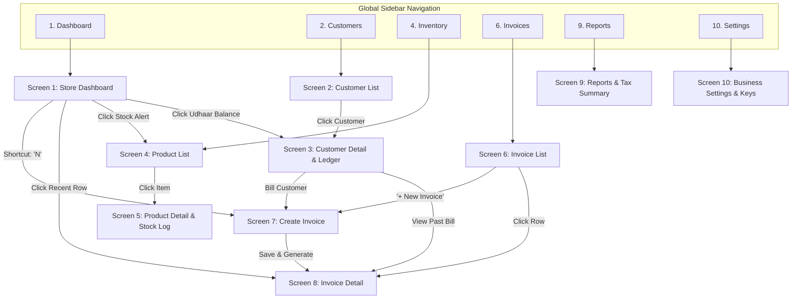

# VyaparKitaab: Core Screens Page Map & Wireframes Blueprint

> **Design Philosophy**: A calm, practical, information-dense business application built for speed, accuracy, and scanability. Focused on real-world Indian MSME workflows (invoicing, inventory, customer udhaar/credit ledger, and tax reporting) rather than decorative dark-mode SaaS templates.

---

## 1. Information Architecture & Page Map



---

## 2. Repeated Design & UI Patterns (Design System Rules)

Every screen follows strict, repeatable rules drawn from Frappe Books, ERPNext, Plane, and Saleor:

1. **Standard Header Block**:
   - `Title` (e.g. "Invoices") + `Breadcrumb` + `Subtitle/Context`
   - Right side: `Secondary Actions` (Export, Filter) + `Primary Action Button` (accent color, clear label e.g., `+ Create Invoice`)
2. **Dense Data Tables**:
   - Monospace font for Numbers, Amounts (`₹1,250.00`), Dates, and Codes (`INV-2026-001`, `SKU-882`).
   - Sticky header row on scroll.
   - Text aligned left; numerical amounts aligned right.
   - Status pills with high-contrast text and subtle tinted backgrounds:
     - `PAID` / `IN STOCK`: Emerald text on light green background.
     - `UNPAID` / `LOW STOCK`: Amber text on light orange background.
     - `OVERDUE` / `OUT OF STOCK`: Rose text on light red background.
     - `DRAFT`: Slate text on light gray background.
3. **Empty States**:
   - Never show a blank table. Provide an illustrative icon, explanation of what belongs here, and a single primary button to create the first record or import data.
4. **Error States**:
   - Inline alert with description of what failed and a clear `[Try Again]` button without forcing a full page reload.
5. **Keyboard First**:
   - Search always accessible via `/` or `Ctrl+K`.
   - New invoice shortcut `N`.
   - Data grid tab-traversal for rapid entry.

---

## 3. Detailed Wireframes for the 10 Core Screens

---

### Screen 1: Store Dashboard

- **Primary Task**: Get a 5-second health check of store finances (today's cash/UPI sales, outstanding receivables, stockouts) and launch core actions.
- **Primary Action**: `[+ Create Invoice]` (Shortcut: `N`).
- **Secondary Actions**: `[+ Add Customer]`, `[+ Add Product]`.

```text
+----------------------------------------------------------------------------------------------------+
|  VyaparKitaab        Search anything (Ctrl+K)...                       [Store: Ramesh Traders v]   |
+----------------------------------------------------------------------------------------------------+
| [=] Dashboard    |  Good Morning, Ramesh                                    [+ Create Invoice (N)] |
|     Customers    |  Tuesday, 14 Oct 2026 · GSTIN: 27AAAAA0000A1Z5                                  |
|     Inventory    +---------------------------------------------------------------------------------+
|     Invoices     | [ Today's Sales ]  [ Outstanding Udhaar ]  [ Low Stock Items ]  [ Pending Invoices ] |
|     Reports      |   ₹ 28,450.00        ₹ 64,200.00              6 Items              3 Drafts     |
|     Settings     |   +12% vs y'day      14 Customers overdue     Action required      Need review  |
|                  +---------------------------------------------------------------------------------+
|                  |                                                 |                               |
|                  | RECENT INVOICES                     [View All]  | ACTION REQUIRED: UDHAAR DUE   |
|                  |-------------------------------------------------|-------------------------------|
|                  | #INV-1042  Pooja General Store  ₹3,400  [PAID]  | Amit Verma         ₹ 4,200    |
|                  | #INV-1041  Kiran Kirana         ₹1,200  [UNPD]  | Overdue by 12d  [WhatsApp Rem]|
|                  | #INV-1040  Vikas Sharma           ₹850  [PAID]  |-------------------------------|
|                  | #INV-1039  Rahul Electricals    ₹9,100  [DRAFT] | Rajesh Gupta       ₹ 8,900    |
|                  | #INV-1038  Sunil Traders        ₹4,500  [PAID]  | Overdue by 5d   [WhatsApp Rem]|
|                  |                                                 |-------------------------------|
|                  |                                                 | LOW STOCK WARNING             |
|                  |                                                 | Tata Salt 1kg       3 pkts rem|
|                  |                                                 | Fortune Oil 1L      1 pouch   |
|                  |                                                 | [Create Purchase Order / PO]  |
+----------------------------------------------------------------------------------------------------+
```

- **Empty State**: Displays an onboarding checklist: "1. Add your store details", "2. Add your first 3 products", "3. Issue your first bill".
- **Mobile View**: Top metrics collapse into a horizontal swipeable carousel; tables transform into compact cards with direct tap-to-call / WhatsApp buttons.

---

### Screen 2: Customer List

- **Primary Task**: Search customer directory, audit individual credit balances (Udhaar), and navigate to customer accounts.
- **Primary Action**: `[+ New Customer]` (Shortcut: `C`).
- **Filters**: Search by Name / Phone / GSTIN; Quick filter pills: `[All (142)]`, `[Has Balance / Udhaar (28)]`, `[Zero Balance (114)]`.

```text
+----------------------------------------------------------------------------------------------------+
| CUSTOMERS                                                                       [+ New Customer]   |
| Manage customer ledger accounts, credit limits, and contact details.                               |
+----------------------------------------------------------------------------------------------------+
| [ Search name, phone, GSTIN...     ] [ Filter: Has Balance v ] [ Sort: Highest Balance v ] [Export] |
+----------------------------------------------------------------------------------------------------+
| Customer Name          Phone          City / GSTIN        Invoices    Total Spent    Balance Due       |
|----------------------------------------------------------------------------------------------------|
| Rajesh Gupta           9820011223     Mumbai              18          ₹ 42,500.00    ₹ 8,900.00 [Pay]  |
| Amit Verma             9819922334     Pune / 27BBB...     12          ₹ 31,000.00    ₹ 4,200.00 [Pay]  |
| Pooja General Store    9765544332     Thane               45          ₹ 1,12,000.00         ₹ 0.00 [-] |
| Kiran Kirana           9821100998     Mumbai              6           ₹ 14,800.00    ₹ 1,200.00 [Pay]  |
| Rahul Enterprises      9890044551     Navi Mumbai         22          ₹ 78,400.00           ₹ 0.00 [-] |
+----------------------------------------------------------------------------------------------------+
| Showing 1 - 5 of 142 customers                                           [< Previous] [1] 2 3 [Next >]     |
+----------------------------------------------------------------------------------------------------+
```

- **Empty State**: "No customers found matching 'xyz'. [Clear Filters] or [+ Add Customer]".
- **Mobile View**: Single column list showing Customer Name (bold), Phone, and colored Balance Due on the right edge.

---

### Screen 3: Customer Detail & Ledger

- **Primary Task**: Review a single customer's full transaction ledger, record cash/UPI payments against their balance, and view past invoices.
- **Primary Action**: `[+ Record Payment Received]` and `[+ Bill Customer]`.

```text
+----------------------------------------------------------------------------------------------------+
| [< Back to Customers]                                                                              |
| Rajesh Gupta                                                      [+ Record Payment]  [+ New Bill] |
| Phone: +91 98200 11223 · Email: rajesh@example.com · GSTIN: Unregistered                           |
+----------------------------------------------------------------------------------------------------+
| [ Total Billed: ₹42,500.00 ]   [ Total Received: ₹33,600.00 ]   [ Outstanding Due: ₹8,900.00 ]    |
|                                                                 (Overdue 5 days · Send WhatsApp)   |
+----------------------------------------------------------------------------------------------------+
| [Ledger Statement]  [Invoices (18)]  [Payments (14)]  [Customer Profile & Notes]                   |
+----------------------------------------------------------------------------------------------------+
| Date         Type       Ref #        Debit (Bill)     Credit (Paid)    Running Balance    Action   |
|----------------------------------------------------------------------------------------------------|
| 12-Oct-2026  Invoice    #INV-1032    ₹ 4,500.00       -                ₹ 8,900.00 Due     [View]   |
| 02-Oct-2026  Payment    REC-441      -                ₹ 5,000.00 (UPI) ₹ 4,400.00 Due     [Receipt]|
| 28-Sep-2026  Invoice    #INV-1011    ₹ 9,400.00       -                ₹ 9,400.00 Due     [View]   |
| 15-Sep-2026  Payment    REC-390      -                ₹ 10,000.00(Cash)       ₹ 0.00      [Receipt]|
+----------------------------------------------------------------------------------------------------+
| [Download PDF Statement]  [Send Statement on WhatsApp]                                            |
+----------------------------------------------------------------------------------------------------+
```

- **Empty State**: (For a newly registered customer) "No transactions recorded yet. Click '+ New Bill' to create their first invoice."

---

### Screen 4: Product / Inventory List

- **Primary Task**: Scan stock levels, search SKUs, view margins, detect low stock items, and adjust stock counts.
- **Primary Action**: `[+ Add Product]` (Shortcut: `P`).
- **Filters**: Search by Item Name / SKU / Barcode; Filter by: `[All Items]`, `[Low Stock (6)]`, `[Out of Stock (1)]`, `[Categories v]`.

```text
+----------------------------------------------------------------------------------------------------+
| INVENTORY & PRODUCTS                                            [Import CSV]  [+ Add Product (P)]  |
| Track SKU stock quantities, purchase/sale pricing, and reorder levels.                             |
+----------------------------------------------------------------------------------------------------+
| [ Search product name, SKU, barcode... ] [ Filter: Low Stock v ] [ Category: All v ]  [Bulk Adjust] |
+----------------------------------------------------------------------------------------------------+
| SKU       Item Name              Category     Stock Level    Cost Price   Sale Price  Margin %     |
|----------------------------------------------------------------------------------------------------|
| SKU-101   Fortune Sunlite 1L     Edible Oil   1 pkt [LOW]    ₹ 115.00     ₹ 135.00    14.8%  [...] |
| SKU-102   Tata Salt Vacuum 1kg   Groceries    3 pkts[LOW]    ₹  22.00     ₹  28.00    21.4%  [...] |
| SKU-103   Aashirvaad Atta 5kg    Flour        24 bags[OK]    ₹ 210.00     ₹ 245.00    14.3%  [...] |
| SKU-104   Maggi Noodles 280g     Snacks       0 pkts[OUT]    ₹  42.00     ₹  50.00    16.0%  [...] |
| SKU-105   Amul Butter 500g       Dairy        18 pcs [OK]    ₹ 240.00     ₹ 275.00    12.7%  [...] |
+----------------------------------------------------------------------------------------------------+
| Showing 1 - 5 of 328 products                                            [< Previous] [1] 2 3 [Next >]     |
+----------------------------------------------------------------------------------------------------+
```

- **Row Actions**: `Edit`, `Quick Stock Adjust (+/-)`, `View Stock History`, `Delete`.

---

### Screen 5: Product Detail & Stock Movement History

- **Primary Task**: Edit product specifications, pricing, tax rates, and review the chronological audit trail of stock ins/outs.
- **Primary Action**: `[Save Changes]` and `[+ Adjust Stock]`.

```text
+----------------------------------------------------------------------------------------------------+
| [< Back to Products]                                                                               |
| Fortune Sunlite Oil 1L (SKU-101)                                      [+ Adjust Stock] [Save Changes] |
+--------------------------------------------------------------------+-------------------------------+
| PRODUCT DETAILS                                                    | CURRENT STOCK STATUS          |
| Item Name:       [ Fortune Sunlite 1L                            ] | 1 unit remaining              |
| SKU:             [ SKU-101         ] Barcode: [ 890123456789     ] | Reorder Threshold: 10 units   |
| Category:        [ Edible Oil      ] Unit:    [ Litre (1L)       ] | Status: [LOW STOCK ALERT]     |
| Cost Price:      [ ₹ 115.00        ] Sale:    [ ₹ 135.00         ] | Total Sold (30d): 84 units    |
| GST Tax Rate:    [ 5%              ] HSN:     [ 1512             ] |                               |
+--------------------------------------------------------------------+-------------------------------+
| STOCK MOVEMENT AUDIT TRAIL                                                                         |
| Date         Event / Reference         Change      Balance After    Logged By       Notes          |
|----------------------------------------------------------------------------------------------------|
| 14-Oct-2026  Sale (Invoice #INV-1042)  -2 units    1 unit           Cashier 1       Standard sale  |
| 12-Oct-2026  Sale (Invoice #INV-1038)  -5 units    3 units          Cashier 1       Standard sale  |
| 08-Oct-2026  Restock (PO-881)          +50 units   8 units          Ramesh (Owner)  Vendor invoice |
| 01-Oct-2026  Manual Adjustment         -2 units    -4 units         Ramesh (Owner)  Damaged bottle |
+----------------------------------------------------------------------------------------------------+
```

---

### Screen 6: Invoice List

- **Primary Task**: Filter, search, and manage all sales and purchase invoices, check payment statuses, and take bulk actions.
- **Primary Action**: `[+ Create Invoice]` (Shortcut: `I`).
- **Filters**: Date Range `[This Month v]`, Status `[All v] | [Unpaid (8)] | [Paid (52)] | [Drafts (3)]`, Type `[Sales v]`.

```text
+----------------------------------------------------------------------------------------------------+
| INVOICES                                                                        [+ Create Invoice] |
| Overview of customer sales invoices, purchase bills, and payment statuses.                         |
+----------------------------------------------------------------------------------------------------+
| [ Search invoice #, customer name... ] [ Date: This Month v ] [ Status: All v ] [ Type: Sale v ]   |
+----------------------------------------------------------------------------------------------------+
| Invoice #    Date         Customer Name            Amount       Due / Paid       Status    Action  |
|----------------------------------------------------------------------------------------------------|
| #INV-1042    14-Oct-2026  Pooja General Store      ₹ 3,400.00   Paid in full     [PAID]    [Print] |
| #INV-1041    13-Oct-2026  Kiran Kirana             ₹ 1,200.00   ₹1,200.00 Due    [UNPAID]  [Pay]   |
| #INV-1040    13-Oct-2026  Vikas Sharma (Cash)        ₹ 850.00   Paid in full     [PAID]    [Print] |
| #INV-1039    12-Oct-2026  Rahul Electricals        ₹ 9,100.00   Draft (unsent)   [DRAFT]   [Edit]  |
| #INV-1038    10-Oct-2026  Rajesh Gupta             ₹ 4,500.00   ₹4,500.00 Due    [OVERDUE] [Remind]|
+----------------------------------------------------------------------------------------------------+
| Showing 1 - 5 of 63 invoices                                             [< Previous] [1] 2 3 [Next >]     |
+----------------------------------------------------------------------------------------------------+
```

- **Quick Actions on Hover**: Print PDF, Send WhatsApp Link, Mark as Paid, Cancel Invoice.

---

### Screen 7: Create Invoice (High-Speed Data Entry)

- **Primary Task**: Rapidly bill a customer with keyboard-first entry (searching items, auto-filling price and tax, calculating totals).
- **Primary Action**: `[Save & Generate Invoice]` (`Ctrl + Enter`).
- **Secondary Action**: `[Save as Draft]`.

```text
+----------------------------------------------------------------------------------------------------+
| NEW SALE INVOICE                                      Invoice #: [ INV-2026-1043 ] Date: [14-Oct] |
+----------------------------------------------------------------------------------------------------+
| CUSTOMER INFORMATION                                                                               |
| Customer: [ Type customer name or phone... (e.g. Ramesh / 98...) ]   [+ Quick Add Customer]        |
| Phone: 98200 11223   ·   GSTIN: Unregistered   ·   Current Balance: ₹ 8,900.00 Due                 |
+----------------------------------------------------------------------------------------------------+
| LINE ITEMS                                                                                         |
| #  Item / Product Search          Qty     Unit Price   Disc %   GST %   Line Total                 |
|----------------------------------------------------------------------------------------------------|
| 1  Fortune Sunlite Oil 1L         2       ₹ 135.00     0%       5%      ₹ 283.50             [ X ] |
| 2  Aashirvaad Atta 5kg            1       ₹ 245.00     ₹10      0%      ₹ 235.00             [ X ] |
| 3  [ Type product name or SKU... ]        [    ]       [  ]     [ 0% ]  ₹   0.00             [ + ] |
+----------------------------------------------------------------------------------------------------+
| [+ Add Row (Enter)]                                                                                |
+--------------------------------------------------------------------+-------------------------------+
| NOTES & TERMS                                                      | BILL TOTALS                   |
| Notes: [ Thank you for your business!                            ] | Subtotal:          ₹   505.00 |
| Payment Terms: [ Due on Receipt                                v ] | Discount:        - ₹    10.00 |
|                                                                    | CGST (2.5%):     + ₹     6.75 |
|                                                                    | SGST (2.5%):     + ₹     6.75 |
| PAYMENT COLLECTED NOW:                                             |-------------------------------|
| Mode: [ (o) Cash  ( ) UPI  ( ) Udhaar / Credit  ( ) Split        ] | GRAND TOTAL:       ₹   508.50 |
| Amount Paid: [ ₹ 508.50       ]  Remaining Balance Due: [ ₹0.00 ]  | (Five Hundred Eight Rupees)   |
+--------------------------------------------------------------------+-------------------------------+
| [Cancel (Esc)]                                    [Save Draft]     [Save & Generate Invoice (Ctrl+Enter)] |
+----------------------------------------------------------------------------------------------------+
```

- **Speed Optimizations**:
  - `Tab` moves smoothly from Product -> Qty -> Unit Price -> Next Row.
  - Hitting `Enter` in the last row automatically creates a new empty item line.
  - Item lookup uses fuzzy debounced search over cached product names and barcodes.

---

### Screen 8: Invoice Detail & Printable Bill

- **Primary Task**: Review invoice contents, collect instant payment via dynamic UPI QR code or payment gateway, print thermal/A4 bill, and send via WhatsApp.
- **Primary Action**: `[Collect Online Payment (UPI)]` and `[Print / PDF]`.
- **Secondary Actions**: `[Send via WhatsApp]`, `[Edit (if Draft)]`, `[Cancel Invoice]`.

```text
+----------------------------------------------------------------------------------------------------+
| [< Back to Invoices]                                                                               |
| Invoice #INV-1041                                          [Print A4] [Thermal] [WhatsApp] [PDF]   |
| Status: [ UNPAID · Due in 3 days ]                         Balance Due: ₹ 1,200.00                 |
+----------------------------------------------------------------------------------------------------+
| ONLINE PAYMENT ACTION BAR                                                                          |
| Collect payment instantly via UPI QR code or customer payment link.                                |
| [ Pay via UPI / Payment Gateway ]  --> Shows Dynamic UPI QR code & Intent URI                     |
+----------------------------------------------------------------------------------------------------+
| +------------------------------------------------------------------------------------------------+ |
| |  RAMESH TRADERS                                                  TAX INVOICE                   | |
| |  Shop 4, Market Yard, Pune - 411037                              Invoice #: INV-1041           | |
| |  GSTIN: 27AAAAA0000A1Z5 · Phone: 9822001122                     Date: 13-Oct-2026             | |
| |------------------------------------------------------------------------------------------------| |
| |  Billed To: Kiran Kirana                                         Place of Supply: Maharashtra  | |
| |  Phone: 98211 00998 · Address: Camp, Pune                        Due Date: 16-Oct-2026         | |
| |------------------------------------------------------------------------------------------------| |
| |  #   Item Description           HSN      Qty    Rate       Disc     Taxable    GST%    Total   | |
| |  1   Fortune Sunlite 1L         1512     5      135.00     0.00     675.00     5%      708.75  | |
| |  2   Tata Salt 1kg              2501     10      28.00     0.00     280.00     0%      280.00  | |
| |  3   Amul Butter 500g           0405     1      201.19     0.00     201.19     5%      211.25  | |
| |------------------------------------------------------------------------------------------------| |
| |  Bank Details:                                                   Subtotal:       ₹ 1,156.19    | |
| |  Bank: HDFC Bank · A/c: 50200012345678                           Total Tax:      + ₹  43.81    | |
| |  IFSC: HDFC0000123 · UPI: ramesh@okhdfcbank                      Grand Total:    ₹ 1,200.00    | |
| |                                                                  Paid Amount:        ₹ 0.00    | |
| |  [ UPI QR CODE EMBEDDED ]                                        Balance Due:    ₹ 1,200.00    | |
| +------------------------------------------------------------------------------------------------+ |
+----------------------------------------------------------------------------------------------------+
```

---

### Screen 9: Reports & Financial Summary

- **Primary Task**: Review business metrics, export GSTR-1 tax tables for filing, inspect customer receivables aging, and review sales trends.
- **Primary Action**: `[Export to Excel (XLSX)]` and `[Date Range Filter]`.
- **Tabs**: `[1. Sales Summary]`, `[2. GSTR-1 Tax Report]`, `[3. Udhaar / Aging Ledger]`, `[4. Stock Valuation]`.

```text
+----------------------------------------------------------------------------------------------------+
| BUSINESS REPORTS & COMPLIANCE                                                     [Export to Excel]|
+----------------------------------------------------------------------------------------------------+
| Date Range: [ This Quarter (Oct - Dec 2026) v ]   Branch: [ All Branches v ]                       |
+----------------------------------------------------------------------------------------------------+
| [Sales Summary]  [GSTR-1 Tax Sheet]  [Udhaar Aging Report]  [Stock Valuation]                      |
+----------------------------------------------------------------------------------------------------+
| UDHAAR / RECEIVABLES AGING SUMMARY                                                                 |
| Total Outstanding: ₹ 64,200.00   | 0-15 Days: ₹ 38,000  | 16-30 Days: ₹ 17,300  | 30+ Days: ₹ 8,900|
+----------------------------------------------------------------------------------------------------+
| Customer Name          Phone          Total Due      0 - 15 Days    16 - 30 Days   > 30 Days (Risk)|
|----------------------------------------------------------------------------------------------------|
| Rajesh Gupta           9820011223     ₹  8,900.00    ₹ 4,500.00     ₹ 4,400.00     -               |
| Amit Verma             9819922334     ₹  4,200.00    -              ₹ 4,200.00     -               |
| Suresh Medical         9822334455     ₹  8,900.00    -              -              ₹ 8,900.00 [!]  |
| Kiran Kirana           9821100998     ₹  1,200.00    ₹ 1,200.00     -              -               |
+----------------------------------------------------------------------------------------------------+
| GSTR-1 OUTWARD SUPPLIES SUMMARY (TAX BREAKDOWN)                                                    |
| Tax Rate (%)     Taxable Value       CGST Amount        SGST Amount        Total Tax Collected     |
| 0% (Exempt)      ₹  48,200.00        ₹      0.00        ₹      0.00        ₹      0.00             |
| 5%               ₹  82,400.00        ₹  2,060.00        ₹  2,060.00        ₹  4,120.00             |
| 12%              ₹  14,500.00        ₹    870.00        ₹    870.00        ₹  1,740.00             |
| 18%              ₹  35,000.00        ₹  3,150.00        ₹  3,150.00        ₹  6,300.00             |
+----------------------------------------------------------------------------------------------------+
```

---

### Screen 10: Business Settings & Payment Setup

- **Primary Task**: Set up business credentials, GST registration, bank account details, and payment gateway keys.
- **Primary Action**: `[Save Settings]`.
- **Navigation (Vertical Tab Layout like Cal.com / Plane)**:
  - `General Profile`
  - `Tax & GSTIN`
  - `Invoice Formatting`
  - `Payment Gateway & UPI`
  - `Staff & Users`

```text
+----------------------------------------------------------------------------------------------------+
| BUSINESS SETTINGS                                                                  [Save Settings] |
+------------------------------------+---------------------------------------------------------------+
| [•] General Store Profile          | PAYMENT GATEWAY & UPI INTEGRATION                             |
| [ ] Tax & GSTIN Settings           | Configure how customers pay you online and via UPI.           |
| [ ] Invoice Numbering & Format     |---------------------------------------------------------------|
| [ ] Payments & Bank Details        | PRIMARY UPI ID (Appears on Printed Invoices & QR Codes)       |
| [ ] Staff & Permissions            | UPI ID:       [ ramesh@okhdfcbank                           ] |
|                                    | Payee Name:   [ Ramesh Traders                              ] |
|                                    |---------------------------------------------------------------|
|                                    | PAYMENT GATEWAY (Online Orders & Auto-Verification)           |
|                                    | Provider:     [ Razorpay (Recommended)                    v ] |
|                                    | Environment:  (o) Live Production   ( ) Test Sandbox          |
|                                    | Key ID:       [ rzp_live_xxxxxxxxxxxxxxxxxxxxxxxx           ] |
|                                    | Key Secret:   [ ••••••••••••••••••••••••••••••••   [Show]   ] |
|                                    | Webhook Secret: [ whsec_•••••••••••••••••••••••••  [Show]   ] |
|                                    |                                                               |
|                                    | Webhook URL to copy into Razorpay dashboard:                  |
|                                    | `https://api.vyaaparkitaab.in/api/v1/payments/webhook`        |
|                                    | [ Test Gateway Connection ]  -> "Gateway connected (Active)"  |
+------------------------------------+---------------------------------------------------------------+
```

---

## 4. Next Steps for Implementation

1. **Keep backend logic intact**: The backend endpoints and tests already support this data model.
2. **Phase UI implementation screen-by-screen**:
   - Begin with **Screen 6 (Invoice List)** and **Screen 7 (Create Invoice)** since invoice generation is the core engine of the system.
   - Refactor **Screen 2 (Customer List)** and **Screen 3 (Ledger)** to give MSMEs instant visibility over customer credit (Udhaar).
3. **Adopt consistent component primitives**:
   - Tables with standard columns, badges, pagination, and empty states.
   - Excel-style data-entry grids for invoices.

